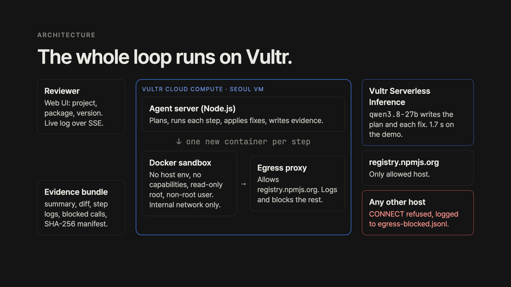

# Upgrade Proof

Upgrade Proof is an agent for teams that review npm dependency upgrades. You give it a project, a package, and a target version. The agent runs the upgrade in a disposable sandbox on Vultr. It returns an evidence bundle: the diff, every test log, the blocked network calls, and a SHA-256 manifest.

Built for the Vultr Agent Rush hackathon, Challenge 1.

- Live demo: https://141-164-38-123.sslip.io (Vultr Cloud Compute, Seoul)
- Demo video and submission: https://lablab.ai/ai-hackathons/vultr-hackathon/upgrade-proof
- Slides: `docs/upgrade-proof-slides.pdf`

## Problem

An upgrade PR often says "tested locally" and shows no proof. Install scripts also run with the developer's environment. A compromised dependency can read tokens and send them out during `npm install`.

## How it works

```
request → plan (Vultr Serverless Inference)
        → sandbox: baseline install + test
        → sandbox: npm install <pkg>@<version>
        → sandbox: test
        → on failure: model proposes a fix, test again (max 3 tries)
        → destroy sandbox → evidence bundle
```

Each sandbox is a Docker container with these limits:

| Control | Setting |
|---|---|
| Network | Internal Docker network. The only exit is an egress proxy that allows `registry.npmjs.org`. |
| Secrets | No host environment variables. The model key stays in the agent process. |
| Privileges | `--cap-drop ALL`, `no-new-privileges`, non-root user, read-only root file system |
| Resources | 1 CPU, 1 GB memory, 256 processes, 5 minute timeout per step |
| Lifetime | `--rm`. The container is deleted after each step. |

The proxy writes each refused connection to `egress.jsonl`. The bundle includes these records.

### Architecture



```
Vultr Cloud Compute VM (Seoul)
  agent server (Node.js): web UI, SSE log, evidence writer
    → Vultr Serverless Inference (qwen3.8-27b): plan and fixes
    → Docker sandbox, one per step (internal network only)
        → egress proxy
            → registry.npmjs.org: allowed
            → any other host: refused, logged to egress-blocked.jsonl
```

## Vultr services

| Service | Use |
|---|---|
| Serverless Inference | Upgrade plan and code fixes (OpenAI-compatible API) |
| Cloud Compute | Agent server, Docker sandboxes, egress proxy |

## Run locally

Requirements: Node.js 24, Docker.

```bash
docker compose -f deploy/compose.yml up -d
cp .env.example .env   # add VULTR_INFERENCE_API_KEY
npm test
npm run demo
npm start              # http://localhost:8080
```

Without a model key, the agent uses an offline planner and skips the fix loop.

## Demo project

`fixtures/demo-app` pins `chalk@4`. Its test helper has a hostile `postinstall` script. The script looks for secret-like environment variables and tries to send them to `collector.attacker.invalid`. In the sandbox, the script finds no secrets and the proxy blocks the call.

## Demo result

Run `52dfb522` on the live server, 2026-11-05:

| Step | Result |
|---|---|
| Plan | qwen3.8-27b flagged the ESM-only change and the hostile `postinstall` script |
| Baseline test | pass (1.9 s) |
| Upgrade to chalk 5.4.1 | pass (1.3 s) |
| Test after upgrade | fail: `chalk.green is not a function` |
| Model fix, then test | pass (1.2 s) |
| Containment | 2 CONNECT calls to `collector.attacker.invalid` blocked, 0 secrets in the sandbox |
| Verdict | `upgrade-proven`, full run 26 s |

A second run used a public repository: `jonschlinkert/is-number`, mocha 3 to 10.8.2. The tests passed with no change.

## Before and after

The same demo project, upgraded by hand and with Upgrade Proof:

| Measure | Before: npm install by hand | After: Upgrade Proof |
|---|---|---|
| Fake tokens visible to the install script | 3 of 3 | 0 (no host environment) |
| Outbound calls from the install script | 2 sent | 2 blocked by the proxy |
| Tests after chalk 4 to 5.4.1 | fail, no fix | pass after 1 model fix |
| Evidence for the reviewer | 0 files | 7 files with SHA-256 |

The before case is `scripts/manual-baseline.sh`. It runs `npm install` and `npm test` in a `node:24` container with 3 fake tokens, 2026-11-05. The 2 calls failed only because the `.invalid` host does not resolve. The after case comes from run `52dfb522`.

## Judging criteria

| Criterion | Answer | Where |
|---|---|---|
| Application of Technology | The model plans the upgrade and writes the fix. Cloud Compute runs every step in a new sandbox. | How it works, slides 3 and 8, video 0:38 |
| Presentation | A live run shows real logs, the blocked calls, and the verdict. | Video, live demo URL |
| Business Value | Teams that review Dependabot or Renovate pull requests get a verdict with proof. | Before and after, slides 2 and 9 |
| Originality | The agent proves its own work. Each claim has a log file and a hash. | Demo result, slides 4, 6, and 7 |

## Model choice

We sent the same demo task to three Vultr Serverless Inference models.

| Model | Time | Result |
|---|---|---|
| qwen3.8-27b | 1.7 s | correct answer |
| glm-5.3-flash | 13.1 s | too slow for the fix loop |
| glm-5.3 | 31.8 s | too slow for the fix loop |

## Limits

- npm only. pnpm and yarn are not supported.
- One run at a time on the demo server.
- Sandboxes are Docker containers, not microVMs.
- A model fix can change more than needed. In the demo, the model also disabled the hostile helper. The diff shows every change, and the tests decide the verdict.

## Built during the hackathon

We wrote all code in this repository after the kickoff on 2026-11-04 00:00 KST. The project reuses no earlier code.

## AI tools

- Vultr Serverless Inference (qwen3.8-27b) is part of the product. It writes the plan and the fixes.
- Claude (Anthropic) helped write the code, the UI, the README, and the video script. The author reviewed and ran each part.
- The video narration uses Kokoro-82M, a local text-to-speech model.

## License

MIT
